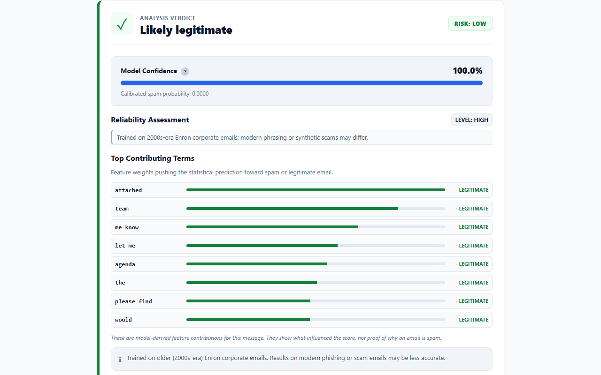
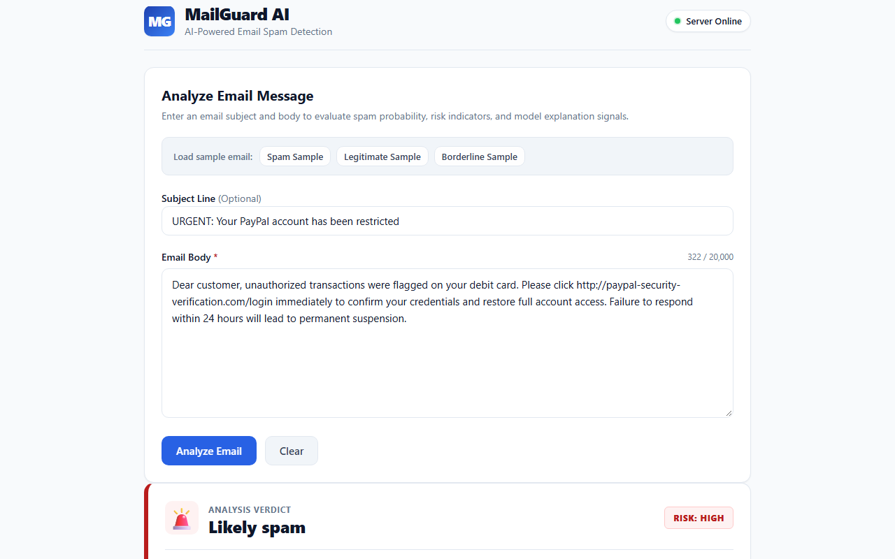
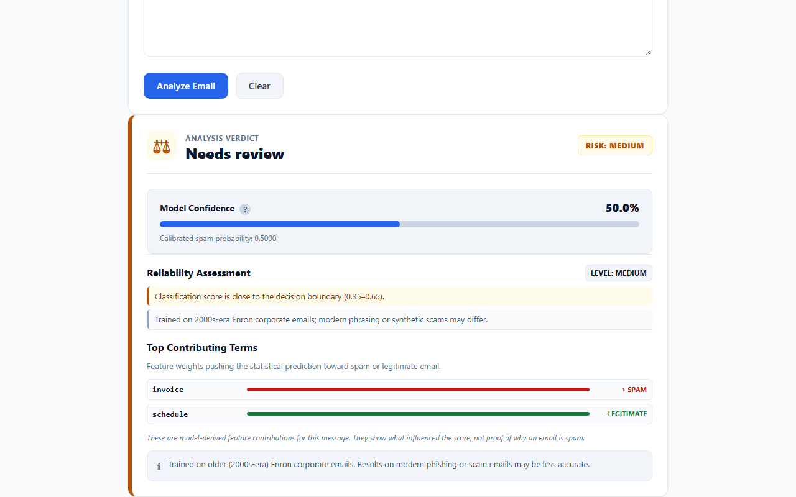
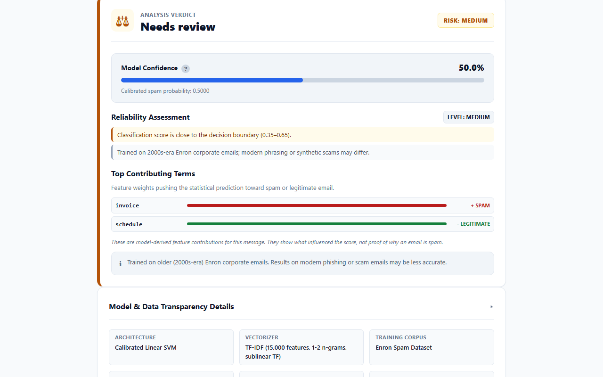
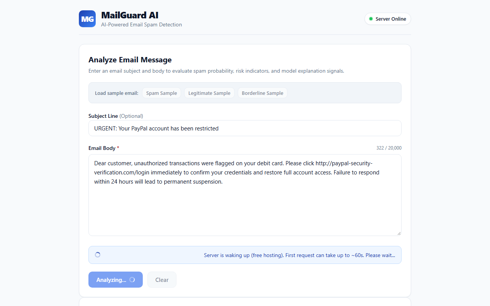
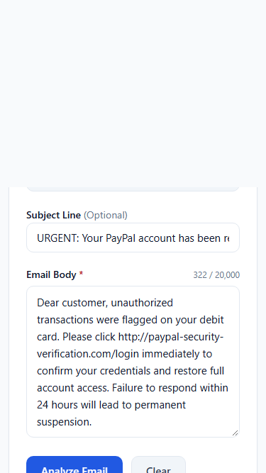

# MailGuard AI 🛡️

[](https://www.python.org/downloads/)
[](https://scikit-learn.org/)
[](https://flask.palletsprojects.com/)
[](#testing--quality-assurance)
[](#1-codebase-license)
[](#2-dataset-attribution)

> **Portfolio Machine Learning System: Email Spam, Ham, and Ambiguity Classifier**  
> MailGuard AI is an end-to-end machine learning system exploring the operational challenges of text classification: false-positive minimization, decision calibration, out-of-distribution detection, explainable token attribution, and cold-start UX handling.  
> *Notice: This is a transparent portfolio demonstration trained on historical corporate emails, not a production spam filter intended to catch modern phishing attacks.*

---

## 📸 Interface & Visual Walkthrough

| Legitimate Email (Ham) | Phishing / Spam Email | Ambiguous / Uncertain Band |
|:---:|:---:|:---:|
|  |  |  |

| Model Transparency Card | Cold Start Resilience Banner (Render Free Tier) | Mobile Responsive Layout (375px) |
|:---:|:---:|:---:|
|  |  |  |

---

## 🏗️ System Architecture & Engineering Principles

```
  User Email Input (Subject + Body)
                 │
                 ▼
  ┌──────────────────────────────────────────────┐
  │         Normalization & Preprocessing        │
  │  • Lowercase, Whitespace & Control Clean     │
  │  • Regex Normalization: __url__, __email__,  │
  │    __number__, __currency__                  │
  └──────────────────────┬───────────────────────┘
                         │
                         ▼
  ┌──────────────────────────────────────────────┐
  │         Feature Extraction & Vectorizer      │
  │  • TF-IDF (Unigrams + Bigrams: (1, 2))       │
  │  • Max Features: 15,000 | Sublinear TF: True │
  └──────────────────────┬───────────────────────┘
                         │
                         ▼
  ┌──────────────────────────────────────────────┐
  │        Calibrated Linear SVM Classifier       │
  │  • LinearSVC(class_weight='balanced')        │
  │  • CalibratedClassifierCV (Platt Scaling)    │
  └──────────────────────┬───────────────────────┘
                         │
        ┌────────────────┴────────────────┐
        ▼                                 ▼
┌───────────────────────────────┐ ┌───────────────────────────────┐
│     Three-Tier Decision       │ │    Reliability & Heuristics   │
│ • P(spam) < 0.40  => Ham      │ │ • Short input (< 10 tokens)   │
│ • [0.40, 0.60]    => Uncertain│ │ • Low vocab coverage (< 50%)  │
│ • P(spam) > 0.60  => Spam     │ │ • Non-English language check  │
└───────────────────────────────┘ └───────────────────────────────┘
```

### Key Engineering Decisions
1. **False Positive Aversion**: In email filtering, misclassifying a legitimate email as spam (False Positive) drops critical communications. The selection protocol enforces **Spam Precision $\ge 0.98$** as a mandatory prerequisite before considering recall or F1 score.
2. **Probability Calibration**: Standard Linear SVMs produce raw uncalibrated decision distances. We wrap `LinearSVC` with `CalibratedClassifierCV` (sigmoid Platt scaling) to yield calibrated posterior probabilities.
3. **Explicit Uncertain Band**: Instead of forcing binary decisions at 0.50, emails with posterior probabilities in **[0.40, 0.60]** are routed to an `uncertain` ("Needs review") status.
4. **Heuristic Guardrails**: When emails contain fewer than 10 tokens, low vocabulary coverage (< 50%), or non-English text, structured reliability warnings are attached.
5. **Cold-Start UX**: Render's free tier spins down idle instances after 15 minutes. If a request takes $> 5\text{s}$, a reassuring warning banner displays a countdown, backed by a 90s timeout and automatic 1-retry flow.

---

## 📊 Model Evaluation & Selection Protocol

The model was selected using **5-Fold Stratified Cross-Validation** on the training split of **24,369** samples (from **30,462** total samples).

### Selection Criterion Hierarchy
- **Priority 1**: Spam Precision $\ge 0.98$ (Disqualifying threshold).
- **Priority 2**: Highest Recall on Spam (Catch the maximum number of threats among qualifying models).
- **Priority 3**: Highest F1 Score.
- *Rule*: Never select based on accuracy alone.

### 5-Fold Stratified Cross-Validation Results (Train Set: $N = 24,369$)

| Model Candidate | CV Precision (Spam) | CV Recall (Spam) | CV F1 Score | CV Accuracy | Status |
|:---|:---:|:---:|:---:|:---:|:---:|
| **Calibrated Linear SVM** | **98.72%** (±0.0022) | **99.29%** (±0.0027) | **99.00%** (±0.0010) | **99.04%** (±0.0010) | **WINNER (Selected)** |
| Multinomial Naive Bayes | 98.24% (±0.0028) | 98.52% (±0.0011) | 98.38% (±0.0009) | 98.45% (±0.0009) | Qualified, Runner-Up |
| Logistic Regression | 97.65% (±0.0025) | 99.41% (±0.0021) | 98.52% (±0.0010) | 98.57% (±0.0010) | **Disqualified** (Precision < 98%) |

*Decision Rationale*: Logistic Regression was disqualified under Priority 1 because its CV precision was only 97.65%. Between the qualifying models, Calibrated Linear SVM dominated Multinomial Naive Bayes on both Recall (99.29% vs 98.52%) and F1 (99.00% vs 98.38%).

---

## 🧪 Independent Held-Out Test Set Performance

Evaluated on the held-out test split of **6,093** emails.

### Set A: Full Held-Out Test Set ($N = 6,093$)
- **Accuracy**: **99.00%**
- **Precision (Spam)**: **98.83%**
- **Recall (Spam)**: **99.07%**
- **F1 Score**: **98.95%**
- **Confusion Matrix**:
  - **True Positives (TP)**: 2,884
  - **True Negatives (TN)**: 3,148
  - **False Positives (FP)**: 34
  - **False Negatives (FN)**: 27

---

## 🔍 Data Leakage & Near-Duplicate Analysis

Pairwise TF-IDF cosine similarity was computed between all 6,093 test emails and the 24,369 training emails.

### Near-Duplicate Findings (17.5% to 19.8% Overlap)
- **Production N-gram Vectorizer `(1, 2)`**: Identifies **1,208** near-duplicates (**19.83%** of the test set).
- **Unigram Vectorizer `(1, 1)`**: Identifies **1,070** near-duplicates (**17.56%** of the test set).
- *Discrepancy Note*: In preliminary exploration, an unigram scratch script reported 1,067 near-duplicates; audited re-execution with exact token boundaries yields 1,070. This 3-email (0.05%) variation is minor and immaterial because **all 61 held-out errors (34 FP, 27 FN) occurred on strictly non-near-duplicate emails**.

### Generalization Comparison Table

| Metric | Full Test Set ($N = 6,093$) | De-Duplicated Test Set ($N = 4,885$) | Net Difference |
|:---|:---:|:---:|:---:|
| **Accuracy** | 99.00% | **98.75%** | -0.25% |
| **Precision (Spam)** | 98.83% | **98.52%** | -0.31% |
| **Recall (Spam)** | 99.07% | **98.82%** | -0.25% |
| **F1 Score** | 98.95% | **98.67%** | -0.28% |
| **False Positives (FP)** | 34 | 34 | 0 (Unchanged) |
| **False Negatives (FN)** | 27 | 27 | 0 (Unchanged) |

> **Audit Takeaway**: Removing all 1,208 near-duplicates leaves 4,885 completely distinct test emails. The model maintains 98.75% accuracy and 98.52% precision. Because false positives and false negatives remain identical (34 FP, 27 FN), model performance is driven by true generalization rather than memorized boilerplate.

---

## 🎯 Uncertain Band Calibration

Tuned on out-of-fold validation predictions across the 24,369 training samples:
- **Band Window**: $[0.40, 0.60]$
- **Samples in Band**: **113** emails (0.46% of training data)
- **Class Distribution in Band**: 58 Ham vs 55 Spam (~50/50 split confirming genuine ambiguity)
- **Performance Outside Band**:
  - Accuracy: **99.20%**
  - Precision: **98.90%**
  - Recall: **99.44%**

---

## ⚠️ Transparent Limitations & Failure Cases

1. **Historical Dataset Context**: Trained on the **Enron Spam Dataset** (~2000–2002 corporate communications). Vocabulary reflects energy trading, corporate operations, and early web marketing.
2. **Domain Shift & Modern Threat Failure Case**: Modern attacks (spear-phishing, business email compromise, invoice fraud) use convincing corporate prose.
   - **Known False Negative in Testing**: In our hand-written sanity set, the invoice fraud email (`Subject: Overdue invoice attached - wire transfer instructions`, `Body: Please review the attached invoice INV-9042 for legal advisory services... Send the wire payment to account #4492048`) was classified as **Legitimate (Ham)** with low spam probability. Because terms like `invoice`, `attached`, and `legal advisory services` frequently occur in legitimate Enron corporate records, the n-gram model fails on this pattern.
3. **Probability Calibration vs Guarantee**: Model confidence is an empirical probability estimate, not a factual guarantee. Confident mistakes can occur.
4. **Language Scope**: Preprocessing is designed for English. Non-English submissions trigger an automated reliability alert.
5. **Short Text**: Inputs under 10 tokens provide minimal TF-IDF context and trigger a `short_input` reliability alert.
6. **Free-Tier Cold Start**: Hosted on Render Free tier with 512 MB RAM and 0.1 CPU; idle instances spin down after 15 minutes, requiring ~30–50s to wake up on the next request.

---

## 🔌 REST API Specification

### 1. `POST /api/predict`
Classifies an email subject and body.

**Request Payload (`application/json`):**
```json
{
  "subject": "Important update on project deliverables",
  "body": "Hi team, please find attached the revised schedule for Q3."
}
```

**Response Payload (`200 OK`):**
```json
{
  "prediction": "ham",
  "label_display": "Legitimate",
  "confidence": 0.9984,
  "spam_probability": 0.0016,
  "risk_level": "low",
  "signals": [
    { "term": "team", "type": "ham", "weight": -0.8421 },
    { "term": "schedule", "type": "ham", "weight": -0.6312 }
  ],
  "reliability": {
    "level": "high",
    "warnings": []
  },
  "dataset_type": "email",
  "model_version": "1.0.0"
}
```

### 2. `GET /api/health`
Health check endpoint used by Render and container orchestrators.
```json
{
  "status": "healthy",
  "model_loaded": true,
  "version": "1.0.0"
}
```

### 3. `GET /api/model-info`
Returns model metadata, parameters, and evaluation metrics.

---

## 🚀 Quickstart & Local Development

### 1. Prerequisites
- Python 3.12+
- Git

### 2. Setup Virtual Environment
```bash
# Clone the repository
git clone https://github.com/sharmikamurugesan/mailguard-ai.git
cd mailguard-ai

# Create and activate virtual environment
python -m venv .venv

# On Linux/macOS:
source .venv/bin/activate

# On Windows:
.\.venv\Scripts\Activate.ps1
```

### 3. Install Dependencies
```bash
# Production runtime dependencies
pip install -r requirements.txt

# Development and testing dependencies
pip install -r requirements-dev.txt
```

### 4. Run Development Server
```bash
python -m src.app
# Server starts at http://127.0.0.1:5000
```

### 5. Run Production Server (Gunicorn)
```bash
gunicorn app:app --bind 0.0.0.0:5000 --workers 1 --threads 4 --timeout 120
```

---

## 🧪 Testing & Quality Assurance

```bash
# Run complete test suite (71 passing tests)
pytest -v -rs

# Run test coverage audit
pytest --cov=src --cov=app --cov-report=term-missing

# Run end-to-end Playwright browser tests (14 UI test cases)
python scripts/verify_ui_browser.py

# Verify README metrics against source-of-truth metadata
python scripts/verify_readme_metrics.py
```

---

## 📦 Deployment to Render

The repository includes a ready-to-use [`render.yaml`](render.yaml) blueprint:
- **Build Command**: `pip install -r requirements.txt`
- **Start Command**: `gunicorn app:app --bind 0.0.0.0:$PORT --workers 1 --threads 4 --timeout 120`
- **Health Check Path**: `/api/health`

For complete instructions, see [docs/DEPLOYMENT.md](docs/DEPLOYMENT.md).

---

## 📜 License & Dataset Attribution

### 1. Codebase License
The source code in this repository is licensed under the terms of the [MIT License](LICENSE). Copyright (c) 2026 Sharmika Murugesan.

### 2. Dataset Attribution
The dataset repository ([MWiechmann/enron_spam_data](https://github.com/MWiechmann/enron_spam_data)) is published under **GPL-3.0**; the underlying Enron email corpus has its own public domain provenance (CALO Project). The raw dataset is not redistributed in this repository (see `data/README.md` for re-download instructions).

*Legal Notice: This summary is provided for transparency and does not constitute formal legal advice regarding the reciprocal licensing obligations of machine learning model weights trained on GPL-licensed corpora.*
