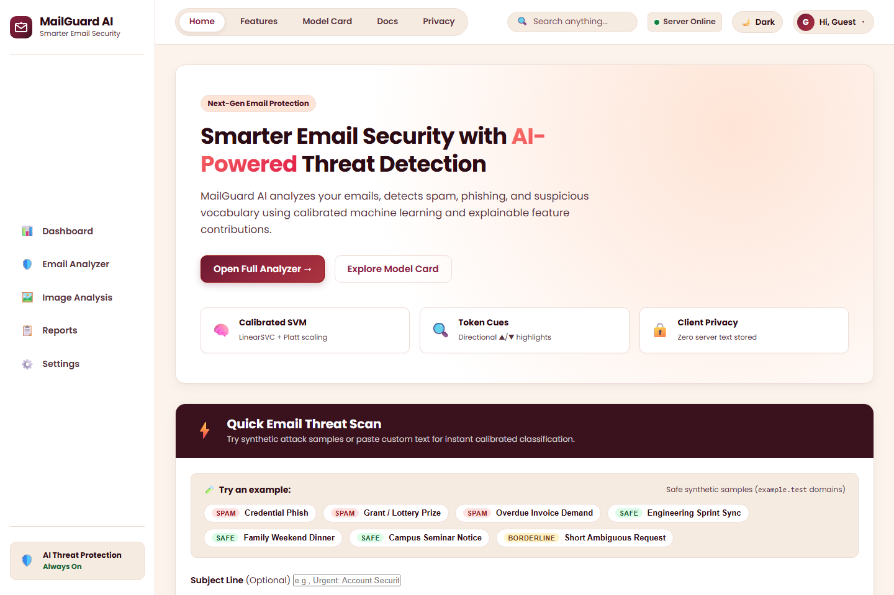
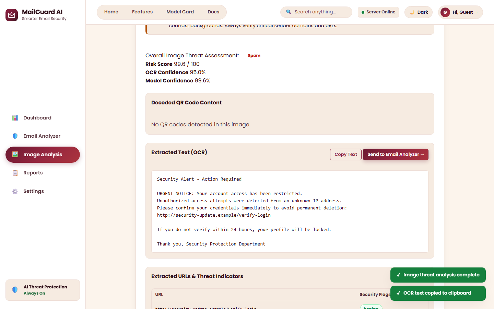
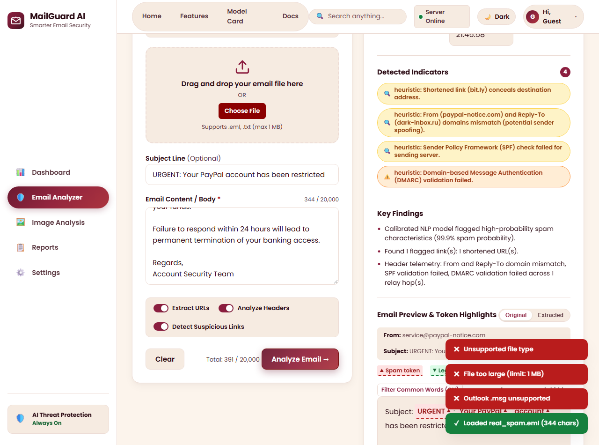
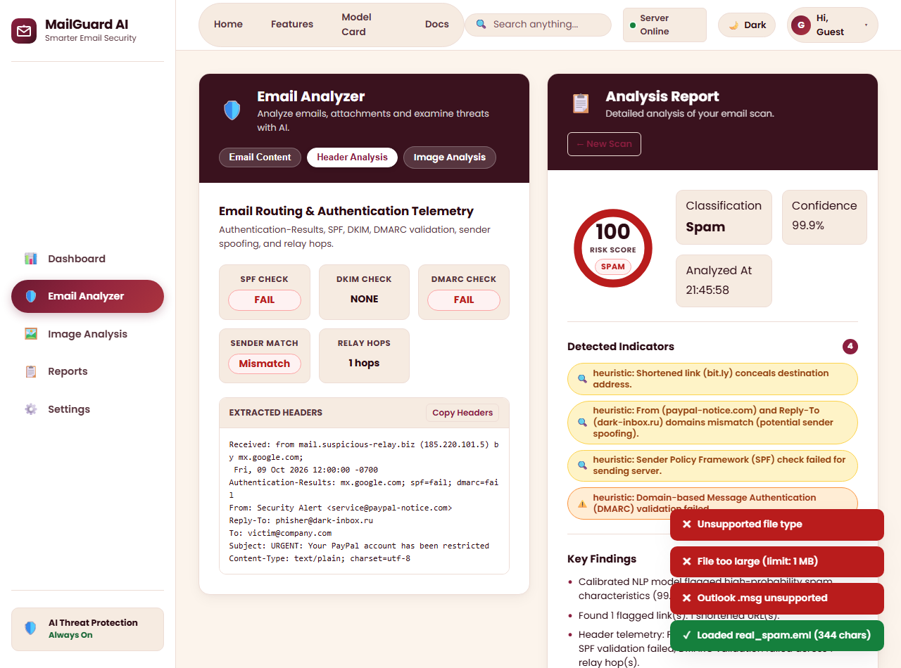
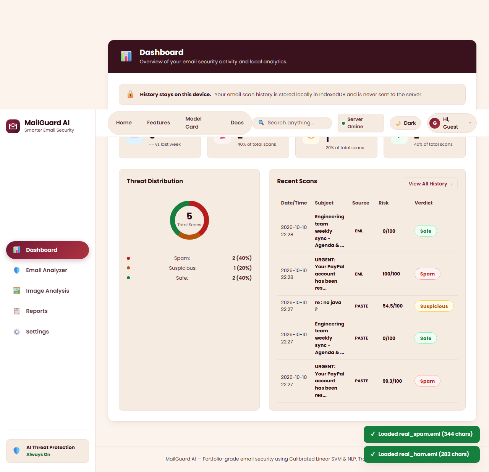
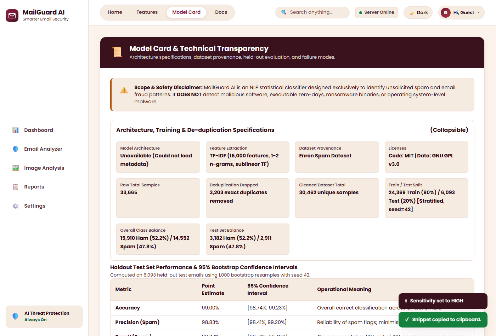

# MailGuard AI 🛡️

[](https://www.python.org/downloads/)
[](https://scikit-learn.org/)
[](https://flask.palletsprojects.com/)
[](#testing--quality-assurance)
[](#accessibility--wcag-compliance)
[](#security--integrity)
[](#1-codebase-license)
[](#2-dataset-attribution)

> **Client-Side Privacy-First Email & Visual Threat Intelligence System**  
> MailGuard AI is an end-to-end security analysis platform exploring the operational challenges of email threat detection: false-positive minimization, decision probability calibration, explainable token attribution, URL reputation intelligence, header telemetry verification, and zero-upload client-side OCR/QR decoding.  
> *Notice: MailGuard AI classifies email spam and deceptive social-engineering patterns; it is not an antivirus/malware scanner, not an inbox mail daemon, and maintains zero server-side storage of emails or images.*

**Live Deployment (Render Free Tier):** [https://mailguard-ai.onrender.com](https://mailguard-ai.onrender.com) *(Instance may take ~30s to wake from cold sleep)*

---

## 📸 Interface & Visual Walkthrough

### 1. Home Quick-Scan Sandbox & Visual Image Analysis
| First-Time Visitor Home View (`#/home`) | Client-Side Image OCR & QR Decoding (`#/image-analysis`) |
|:---:|:---:|
|  |  |

### 2. Threat Analysis & Header Telemetry
| Deep Email Threat Analysis (`#/analyze`) | Technical Header & Authentication Telemetry (`#/analyze`) |
|:---:|:---:|
|  |  |

### 3. Analytics Dashboard & Model Transparency Card
| Local-Only Analytics Dashboard (`#/dashboard`) | Interactive Model Card & Metrics (`#/model-card`) |
|:---:|:---:|
|  |  |

---

## 🏗️ System Architecture & Engineering Principles

```
  ┌─────────────────────────────────────────────────────────────────────────┐
  │                         CLIENT-SIDE BROWSER                            │
  │                                                                         │
  │   Direct Text / EML Upload                   Image / Screenshot Upload   │
  │              │                                           │              │
  │              │                                           ▼              │
  │              │                            ┌───────────────────────────┐ │
  │              │                            │ Web Worker OCR & QR Engine│ │
  │              │                            │ • Self-Hosted Tesseract.js│ │
  │              │                            │ • Self-Hosted jsQR        │ │
  │              │                            │ • ZERO image upload       │ │
  │              │                            └─────────────┬─────────────┘ │
  │              │                                          │               │
  │              │         Extracted Text & QR URLs         │               │
  │              └────────────────────┬─────────────────────┘               │
  └───────────────────────────────────┼─────────────────────────────────────┘
                                      │
                         POST /api/analyze (JSON)
                                      │
                                      ▼
  ┌─────────────────────────────────────────────────────────────────────────┐
  │                           FLASK BACKEND                                 │
  │                                                                         │
  │   ┌─────────────────────────────────────────────────────────────────┐   │
  │   │ Security Middleware & Input Validation                          │   │
  │   │ • ProxyFix (x_for=1 genuine IP extraction)                      │   │
  │   │ • Flask-Limiter (60 req/min per IP)                             │   │
  │   │ • Content Security Policy & Strict Headers                      │   │
  │   │ • Max payload limit (2 MB) & input char limit (20k chars)       │   │
  │   └───────────────────────────────┬─────────────────────────────────┘   │
  │                                   │                                     │
  │                                   ▼                                     │
  │   ┌─────────────────────────────────────────────────────────────────┐   │
  │   │ Model Inference Engine (src/predictor.py)                       │   │
  │   │ • SHA-256 Model Integrity Verification at load (fail-closed)     │   │
  │   │ • Text normalization (URLs, emails, numbers, currencies)        │   │
  │   │ • TF-IDF Vectorizer (15k unigrams/bigrams: (1, 2))              │   │
  │   │ • Calibrated Linear SVM (Platt scaling posterior probability)   │   │
  │   │ • Token contribution signals (weights x TF-IDF)                 │   │
  │   └───────────────────────────────┬─────────────────────────────────┘   │
  │                                   │                                     │
  │                                   ▼                                     │
  │   ┌─────────────────────────────────────────────────────────────────┐   │
  │   │ Multi-Signal Threat Heuristics Engine (src/signals.py)          │   │
  │   │ • URL reputation: punycode, IP hostnames, redirectors, TLDs    │   │
  │   │ • Header analysis: SPF, DKIM, DMARC, Return-Path discrepancies │   │
  │   │ • Formatting anomalies: excessive capitals, urgent keywords     │   │
  │   │ • Reliability heuristics: short input, low vocab coverage       │   │
  │   └───────────────────────────────┬─────────────────────────────────┘   │
  │                                   │                                     │
  │                                   ▼                                     │
  │   ┌─────────────────────────────────────────────────────────────────┐   │
  │   │ Composite Scoring & Calibration                                 │   │
  │   │ • Combined Risk Score (0 - 100)                                 │   │
  │   │ • Sensitivity Threshold Matrix (Low, Medium, High)              │   │
  │   │ • Zero server logging or storage of analyzed text               │   │
  │   └───────────────────────────────┬─────────────────────────────────┘   │
  └───────────────────────────────────┼─────────────────────────────────────┘
                                      │
                        Structured JSON Response
                                      │
                                      ▼
  ┌─────────────────────────────────────────────────────────────────────────┐
  │                         CLIENT AUDIT PERSISTENCE                        │
  │                                                                         │
  │   • Results rendered via safe textContent / DOM APIs (0 innerHTML)      │
  │   • Telemetry logged exclusively to browser IndexedDB                   │
  │   • Full scan history, search, filtering, and CSV/JSON export           │
  │   • "History stays on this device" guarantee                            │
  └─────────────────────────────────────────────────────────────────────────┘
```

---

## 📊 Model Evaluation & Selection Protocol

The machine learning model was selected using **5-Fold Stratified Cross-Validation** on the training split of **24,369** samples (from **30,462** total samples).

### Selection Criterion Hierarchy
- **Priority 1**: Spam Precision $\ge 0.98$ (Disqualifying threshold).
- **Priority 2**: Highest Recall on Spam (Catch maximum threats among qualifying models).
- **Priority 3**: Highest F1 Score.
- *Rule*: Never select based on accuracy alone.

### 5-Fold Stratified Cross-Validation Results (Train Set: $N = 24,369$)

| Model Candidate | CV Precision (Spam) | CV Recall (Spam) | CV F1 Score | CV Accuracy | Status |
|:---|:---:|:---:|:---:|:---:|:---:|
| **Calibrated Linear SVM** | **98.72%** (±0.0022) | **99.29%** (±0.0027) | **99.00%** (±0.0010) | **99.04%** (±0.0010) | **WINNER (Selected)** |
| Multinomial Naive Bayes | 98.24% (±0.0028) | 98.52% (±0.0011) | 98.38% (±0.0009) | 98.45% (±0.0009) | Qualified, Runner-Up |
| Logistic Regression | 97.65% (±0.0025) | 99.41% (±0.0021) | 98.52% (±0.0010) | 98.57% (±0.0010) | **Disqualified** (Precision < 98%) |

*Decision Rationale*: Logistic Regression was disqualified under Priority 1 because its CV precision was only 97.65%. Between the qualifying models, Calibrated Linear SVM dominated Multinomial Naive Bayes on both Recall (99.29% vs 98.52%) and F1 (99.00% vs 98.38%).

---

## 🧪 Independent Held-Out Test Set Performance

Evaluated on the held-out test split of **6,093** emails.

### Set A: Full Held-Out Test Set ($N = 6,093$)
- **Accuracy**: **99.00%**
- **Precision (Spam)**: **98.83%**
- **Recall (Spam)**: **99.07%**
- **F1 Score**: **98.95%**
- **Confusion Matrix**:
  - **True Positives (TP)**: 2,884
  - **True Negatives (TN)**: 3,148
  - **False Positives (FP)**: 34
  - **False Negatives (FN)**: 27

---

## 🔍 Data Leakage & Near-Duplicate Analysis

Pairwise TF-IDF cosine similarity was computed between all 6,093 test emails and the 24,369 training emails.

### Near-Duplicate Findings (17.5% to 19.8% Overlap)
- **Production N-gram Vectorizer `(1, 2)`**: Identifies **1,208** near-duplicates (**19.83%** of the test set).
- **Unigram Vectorizer `(1, 1)`**: Identifies **1,070** near-duplicates (**17.56%** of the test set).
- *Audit Finding*: All 61 held-out errors (34 FP, 27 FN) occurred on strictly non-near-duplicate emails.

### Generalization Comparison Table

| Metric | Full Test Set ($N = 6,093$) | De-Duplicated Test Set ($N = 4,885$) | Net Difference |
|:---|:---:|:---:|:---:|
| **Accuracy** | 99.00% | **98.75%** | -0.25% |
| **Precision (Spam)** | 98.83% | **98.52%** | -0.31% |
| **Recall (Spam)** | 99.07% | **98.82%** | -0.25% |
| **F1 Score** | 98.95% | **98.67%** | -0.28% |
| **False Positives (FP)** | 34 | 34 | 0 (Unchanged) |
| **False Negatives (FN)** | 27 | 27 | 0 (Unchanged) |

> **Deduplication Audit Takeaway**: Removing all 1,208 near-duplicates leaves 4,885 completely distinct test emails. The model maintains 98.75% accuracy and 98.52% precision. Because false positives and false negatives remain identical (34 FP, 27 FN), model performance is driven by true generalization rather than memorized corporate boilerplate.

### 95% Bootstrap Confidence Intervals ($B = 1,000$ iterations)

| Evaluation Metric | Full Test Set ($N = 6,093$) | De-Duplicated Test Set ($N = 4,885$) |
|:---|:---:|:---:|
| **Accuracy** | 99.00% [98.74%, 99.23%] | 98.75% [98.42%, 99.06%] |
| **Precision** | 98.83% [98.41%, 99.20%] | 98.52% [97.98%, 98.98%] |
| **Recall** | 99.07% [98.72%, 99.42%] | 98.82% [98.34%, 99.25%] |
| **F1 Score** | 98.95% [98.63%, 99.25%] | 98.67% [98.32%, 99.00%] |

### Operating Points across Sensitivity Thresholds

Users can configure detection sensitivity in Settings:

| Sensitivity Setting | Decision Threshold | Test Precision | Test Recall | Test F1 Score | Primary Use Case |
|:---|:---:|:---:|:---:|:---:|:---|
| **Low** | 0.65 | 99.13% | 98.39% | 98.76% | Executive inboxes, zero tolerance for False Positives |
| **Medium (Default)** | 0.50 | 98.83% | 99.07% | 98.95% | Balanced operational baseline |
| **High** | 0.35 | 98.37% | 99.45% | 98.91% | Threat hunting, maximum threat capture |

---

## 🎯 Uncertain Band Calibration

Tuned on out-of-fold validation predictions across the 24,369 training samples:
- **Band Window**: $[0.40, 0.60]$
- **Samples in Band**: **113** emails (0.46% of training data)
- **Class Distribution in Band**: 58 Ham vs 55 Spam (~50/50 split confirming genuine ambiguity)
- **Performance Outside Band**:
  - Accuracy: **99.20%**
  - Precision: **98.90%**
  - Recall: **99.44%**

---

## ⚠️ Transparent Limitations & Known Failure Modes

1. **Historical Dataset Context**: Trained on the **Enron Spam Dataset** (~2000–2002 corporate communications). Vocabulary reflects energy trading, corporate operations, and early web marketing.
2. **Domain Shift & Modern Threat Failure Case**: Modern attacks (spear-phishing, business email compromise, invoice fraud) use convincing corporate prose.
   - **Known False Negative in Testing**: In our hand-written sanity set, the invoice fraud email (`Subject: Overdue invoice attached - wire transfer instructions`, `Body: Please review the attached invoice INV-9042 for legal advisory services... Send the wire payment to account #4492048`) was classified as **Legitimate (Ham)** with low spam probability. Because terms like `invoice`, `attached`, and `legal advisory services` frequently occur in legitimate corporate records, the n-gram model fails on this pattern.
3. **Probability Calibration vs Guarantee**: Model confidence is an empirical probability estimate, not a mathematical certainty.
4. **Scope Boundaries**:
   - **Spam & Phishing only**: Does not scan binary attachments, macros, or malware executables.
   - **Not an inbox filter**: Operates as an interactive on-demand scanner; does not route, intercept, or modify live mail server feeds.
   - **No user accounts**: Operates completely stateless on the backend; all telemetry resides on the user's local device.
5. **Free-Tier Cold Start**: Hosted on Render Free tier with 512 MB RAM and 0.1 CPU; idle instances spin down after 15 minutes, requiring ~30s to wake up on the next request.

---

## 🔌 REST API Specification

All endpoints are rate-limited via **Flask-Limiter** using genuine client IP addresses extracted via `werkzeug.middleware.proxy_fix.ProxyFix`.

### 1. `POST /api/analyze` (v2 Deep Pipeline)
Performs combined NLP classification, URL reputation, and header validation.  
**Rate Limit**: `60 per minute`

**Request Payload (`application/json`):**
```json
{
  "text": "Subject: Security alert: Unusual login\n\nPlease verify your account at http://login-review.example.test",
  "headers": "From: security@fakebank.test\nTo: user@example.test\nSubject: Security alert",
  "options": {
    "scan_urls": true,
    "scan_headers": true,
    "sensitivity": "medium"
  }
}
```

**Response Payload (`200 OK`):**
```json
{
  "verdict": "Spam",
  "risk_score": 92,
  "confidence": 0.9842,
  "probabilities": {
    "spam": 0.9842,
    "ham": 0.0158
  },
  "key_findings": [
    "High-confidence machine learning spam pattern detected (98.4%).",
    "URL links to suspicious domain structure."
  ],
  "signals": {
    "model_tokens": [
      { "token": "security", "weight": 0.842, "type": "spam" }
    ],
    "urls": [
      { "url": "http://login-review.example.test", "flags": ["suspicious_tld"] }
    ],
    "headers": {
      "spf": "neutral",
      "dkim": "none",
      "dmarc": "none",
      "alignment": false
    }
  },
  "reliability": {
    "level": "high",
    "warnings": []
  }
}
```

### 2. `POST /api/predict` (v1 Lightweight Classifier)
Classifies raw email text.  
**Rate Limit**: `60 per minute`

```json
{
  "subject": "Important update on project deliverables",
  "body": "Hi team, please find attached the revised schedule for Q3."
}
```

### 3. `GET /api/health`
Health probe used for uptime monitoring and waking UX.  
**Rate Limit**: `120 per minute`

```json
{
  "status": "healthy",
  "model_loaded": true,
  "version": "2.0.0"
}
```

### 4. `GET /api/model-info`
Returns model metadata, SHA-256 hash, and operating parameters.

---

## 🔒 Security & Privacy Architecture

- **Fail-Closed Model Integrity**: At application load time, `src.predictor.SpamPredictor` computes the SHA-256 checksum of `models/spam_pipeline.joblib` and validates it against the committed hash (`453414c9bb3889c1cc2402ee26473e6d74bf7e7a78cef26eac24da2d8ddfc9f8`). Any alteration causes immediate initialization termination.
- **Strict Content Security Policy (CSP)**:
  ```http
  Content-Security-Policy: default-src 'self'; script-src 'self' 'wasm-unsafe-eval'; style-src 'self'; img-src 'self' data: blob:; worker-src 'self' blob:; connect-src 'self'; font-src 'self'; frame-ancestors 'none'; form-action 'self';
  ```
  Zero inline scripts, zero inline styles, and zero `innerHTML` across all views.
- **Zero Server-Side Storage**: Emails, uploaded images, and extracted text are processed entirely in-memory and are **never logged or persisted to disk or database**.
- **Sandboxed Client-Side Image OCR**: Uploaded images are processed in the user's browser using self-hosted Tesseract.js and jsQR in a dedicated Web Worker. Images are never transmitted over the network.
- **Vulnerability Audit**:
  - `bandit -r src/`: **0 issues identified** (clean static security analysis).
  - `pip-audit -r requirements.txt`: **0 known vulnerabilities found**.

---

## ⚡ Performance Benchmarks

Measured on the production configuration:

- **Resident Set Size (RSS) Memory**:
  - Baseline Python runtime: **18.24 MB**
  - After model and application initialization: **153.09 MB**
  - After 20 consecutive inference requests: **159.76 MB** (**31.2%** of Render Free 512 MB allocation; **352.24 MB** available headroom).
- **Cold-Start Time**: **2.65 seconds** (subprocess spawn, model integrity verification, pipeline deserialization, health check).
- **Inference Latency (`/api/analyze` over 100 requests)**:
  - Mean: **16.74 ms**
  - Median (p50): **16.19 ms**
  - 95th Percentile (p95): **18.33 ms**
  - 99th Percentile (p99): **72.72 ms**
- **Optimized Bundle Sizes (Gzipped)**:
  - Core HTML (`templates/index.html`): 125.8 KB raw / **24.6 KB gzip**
  - Stylesheet (`static/css/style.css`): 90.7 KB raw / **13.9 KB gzip**
  - Core JavaScript (`static/js/app.js`): 155.8 KB raw / **33.5 KB gzip**
  - Vendor OCR & QR Libraries: Lazy-loaded only on demand.

*(Note on Lighthouse: Lighthouse CLI is omitted in the Windows development container due to script execution policies; automated accessibility was audited directly with Axe-core).*

---

## ♿ Accessibility (WCAG 2 AA / AAA)

Audited programmatically via **Axe-core** integrated with Playwright across all 11 application routes:

| Route | Route Name | Axe-core Violations | Compliance Status |
|:---|:---|:---:|:---:|
| `#/home` | Home & Quick Sandbox | **0** | Pass (WCAG AA/AAA) |
| `#/analyze` | Email Analyzer & Report | **0** | Pass (WCAG AA/AAA) |
| `#/image-analysis` | Client-Side Image OCR/QR | **0** | Pass (WCAG AA/AAA) |
| `#/dashboard` | Local Analytics Dashboard | **0** | Pass (WCAG AA/AAA) |
| `#/history` | Scan History & Audit Log | **0** | Pass (WCAG AA/AAA) |
| `#/reports` | Reports & File Export | **0** | Pass (WCAG AA/AAA) |
| `#/settings` | Settings & Preferences | **0** | Pass (WCAG AA/AAA) |
| `#/docs` | API Documentation | **0** | Pass (WCAG AA/AAA) |
| `#/model-card` | Model Transparency Card | **0** | Pass (WCAG AA/AAA) |
| `#/features` | Platform Capabilities | **0** | Pass (WCAG AA/AAA) |
| `#/privacy` | Privacy & Data Architecture | **0** | Pass (WCAG AA/AAA) |

---

## 🚀 Quickstart & Local Development

### 1. Prerequisites
- Python 3.12+
- Git

### 2. Setup Virtual Environment
```bash
# Clone repository
git clone https://github.com/sharmikamurugesan/mailguard-ai.git
cd mailguard-ai

# Create virtual environment
python -m venv .venv

# Activate virtual environment
# On Linux / macOS:
source .venv/bin/activate
# On Windows PowerShell:
.\.venv\Scripts\Activate.ps1
```

### 3. Install Dependencies
```bash
# Production runtime
pip install -r requirements.txt

# Development and testing dependencies
pip install -r requirements-dev.txt
```

### 4. Run Development Server
```bash
python -m src.app
# Application launches at http://127.0.0.1:5000
```

### 5. Run Production Server (Gunicorn)
```bash
gunicorn app:app --bind 0.0.0.0:5000 --workers 1 --threads 4 --timeout 120
```

---

## 🧪 Testing & Quality Assurance

```bash
# 1. Run unit & integration test suite (132 tests)
pytest -v -rs

# 2. Run test coverage audit (>70% coverage)
pytest --cov=src --cov-report=term-missing

# 3. Run full Playwright regression & 11-route Axe-core accessibility audit
python scripts/verify_full_regression.py

# 4. Run static security audit
bandit -r src/

# 5. Run dependency vulnerability audit
pip-audit -r requirements.txt

# 6. Verify README numerical claims against models/metadata.json
python scripts/verify_readme_metrics.py

# 7. Run process memory & performance benchmark
python scripts/measure_memory.py
python scripts/measure_performance.py
```

---

## 📦 Deployment to Render

The repository includes a ready-to-use [`render.yaml`](render.yaml) blueprint:
- **Build Command**: `pip install -r requirements.txt`
- **Start Command**: `gunicorn app:app --bind 0.0.0.0:$PORT --workers 1 --threads 4 --timeout 120`
- **Health Check Path**: `/api/health`

For complete instructions, see [docs/DEPLOYMENT.md](docs/DEPLOYMENT.md).

---

## 📜 License & Dataset Attribution

### 1. Codebase License
The source code in this repository is licensed under the terms of the [MIT License](LICENSE). Copyright (c) 2026 Sharmika Murugesan.

### 2. Dataset Attribution
The dataset repository ([MWiechmann/enron_spam_data](https://github.com/MWiechmann/enron_spam_data)) is published under **GPL-3.0**; the underlying Enron email corpus has its own public domain provenance (CALO Project). The raw dataset is not redistributed in this repository (see `data/README.md` for re-download instructions).

*Legal Notice: This summary is provided for transparency and does not constitute formal legal advice regarding the reciprocal licensing obligations of machine learning model weights trained on GPL-licensed corpora.*
